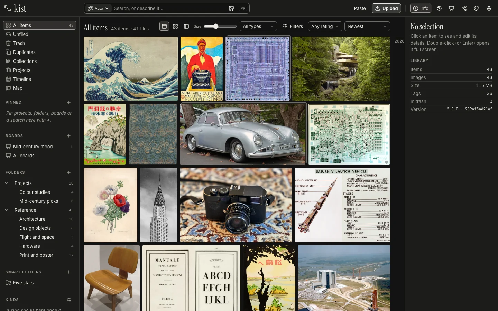
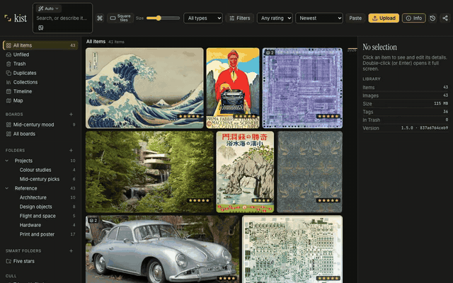
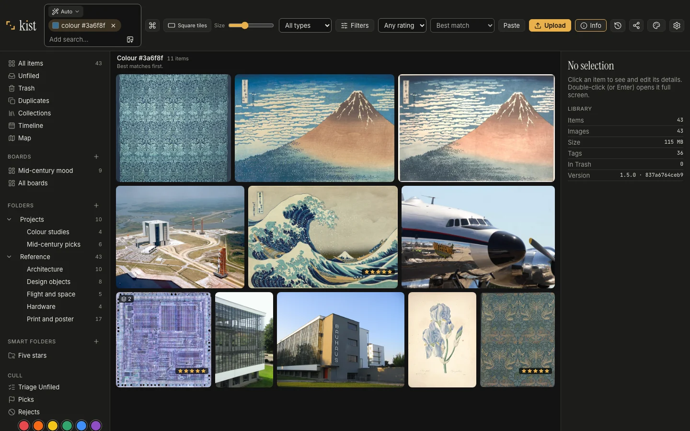
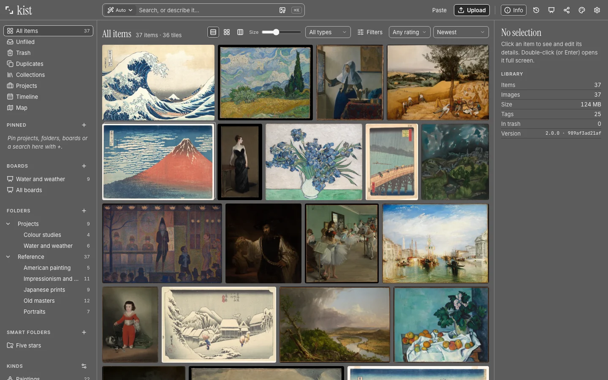
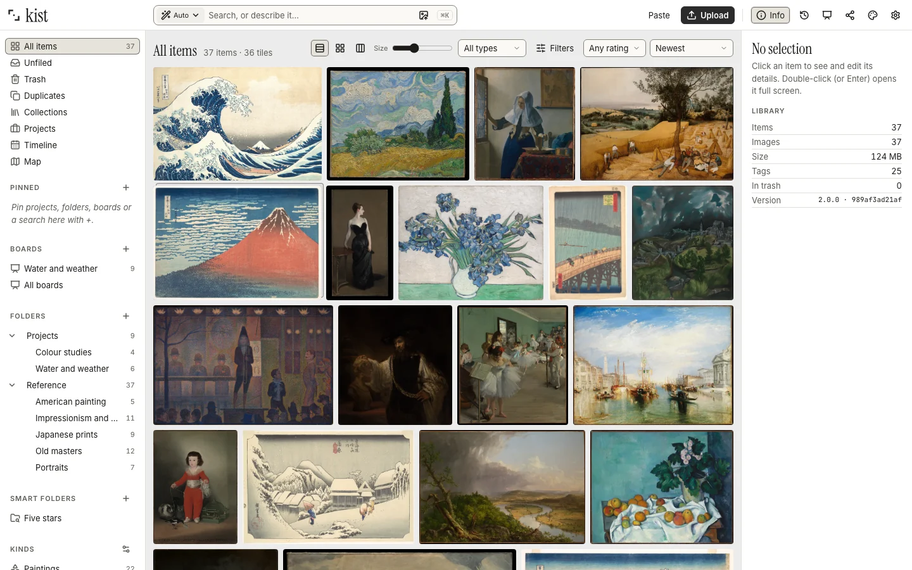

# Keep what catches your eye. { .kist-hero__line }

Kist is a self-hosted library for the images, screenshots, PDFs, video and
design files you collect. A fast grid on your own server, plain files on disk,
and an MCP endpoint so Claude and other agents can search it, see it and file
things for you.

[Install](install.md){ .md-button .md-button--primary } [Connect an agent](mcp.md){ .md-button }

{ .kist-shot }

<strong>Plain files</strong>Every item is a folder: the untouched original, its previews and a `meta.json`. Back it up with `rsync`; rebuild the database from disk at any time.

<strong>One compose stack</strong>`docker compose up` runs the app, a worker, Postgres and a small AI service. Fine on a home server or a NAS; no GPU, no cloud.

<strong>Agents built in</strong>A streamable-HTTP MCP endpoint: agents search, *see* the image, add, tag and file. Every change undoes in one step, and nothing an agent does deletes for good.

## See it move

{ .kist-shot }

## What it does

- **Find by meaning, colour and text.** "Moody dark interiors", a colour from
  a palette, the words inside a screenshot, or "more like this", all on your
  own hardware (OpenCLIP and RapidOCR on ONNX Runtime, CPU only).
- **Organise your way.** Nested folders (an item can be in several), tags with
  aliases and implied tags, ratings, smart folders, stacks, duplicates and
  suggested collections.
- **Creative workflows.** Moodboards, pick/reject culling, colour labels,
  annotations pinned to a spot or a video time, versions and compare.
- **More than images.** Video with scrubbing and clips, audio, RAW and HEIC
  with camera data, PDFs, SVG, fonts, 3D models, design files, a timeline and
  a map.
- **In and out.** Paste, drag, a browser extension, an iPhone share-sheet
  Shortcut, importers (Eagle, Pinterest, Are.na, Raindrop, Google Takeout,
  Apple Photos), share links, BagIt exports with an offline index.
- **On your phone.** Install it to the Home Screen; tap stars, tags, Move to…
  and Trash with Undo, and it opens offline.

{ .kist-shot }

## Three themes

Dark, light and gallery grey, which puts every image and the whole interface
on one neutral mid-grey for judging colour.

=== "Gallery grey"
    { .kist-shot }
=== "Light"
    { .kist-shot }
=== "Dark"
    { .kist-shot }

## Coming from Eagle?

Kist reads an Eagle `.library` folder directly: folders, tags, ratings, notes,
source URLs, the trash and simple smart folders come across, and a dry run
shows what will happen first. Your files then live as plain files on a server
you own, reachable from every device and from your agents.
[Coming from Eagle](coming-from-eagle.md).
