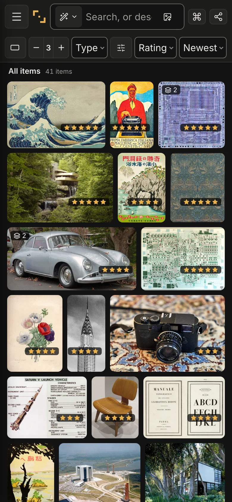
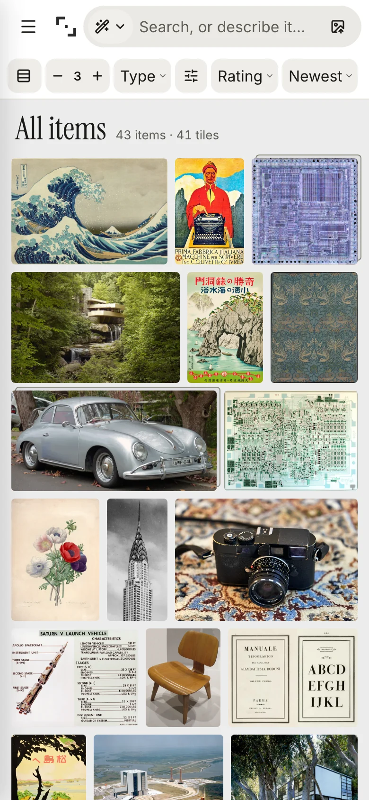
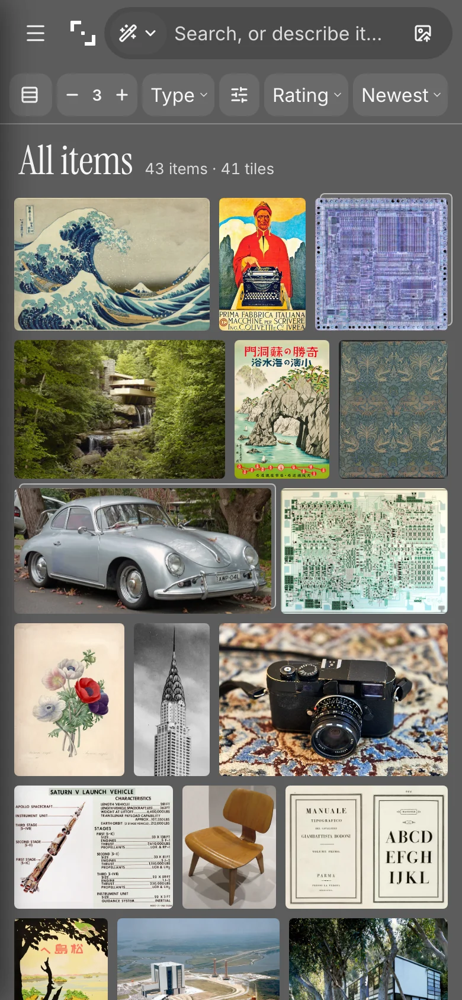
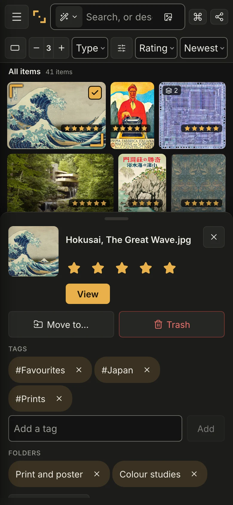
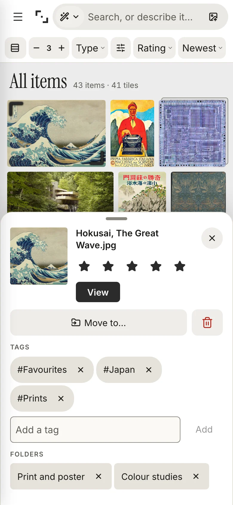
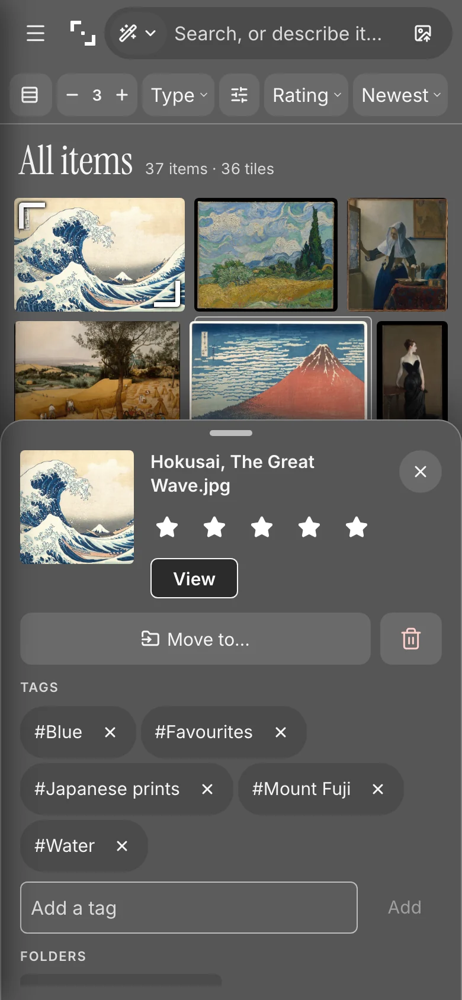

# Phone and PWA

Kist is a web app you can install. On a phone it has its own layout: a
justified grid, an item sheet you pull up, and full-screen viewing with
swipes.

## Install it

Kist must be served over **HTTPS** (see [Install](install.md#reverse-proxy-and-https)).

- **iPhone and iPad:** open Kist in Safari, then Share → **Add to Home
  Screen**. The first visit shows a one-time hint.
- **Android:** Chrome offers **Install app** in its menu.
- **Desktop:** Chrome and Edge show an install button in the address bar.

Installed, Kist opens full screen with its own icon, and the icon shows how
many items wait in Unfiled (where the system supports app badges).

## What you can do on the phone

Tap stars, add and remove tags (with suggestions from your own tags), **Move
to…** a folder (a search, your five recent folders and the whole tree), and
**Trash** with Undo. Every change is one batch in Recent changes. Notes,
renaming, folder management, smart folders and Settings stay on the computer;
a read-only token sees no edit controls.

## Offline

A service worker keeps the app shell (the page, scripts, styles, fonts and
icons), so Kist opens without a connection and says it is offline. It never
stores anything from your library: no item files, thumbnails, API answers,
MCP or share pages. A new version installs in the background and offers
**Reload**.

## Saving from other apps

- **iPhone share sheet:** a "Save to Kist" Shortcut sends images, files and
  links from any app. [Step by step](ios-shortcut.md).
- **Browser extension** (Firefox and Chrome) and the **bookmarklet**: Settings →
  Phone & browser. Give them an `add`-only token.
